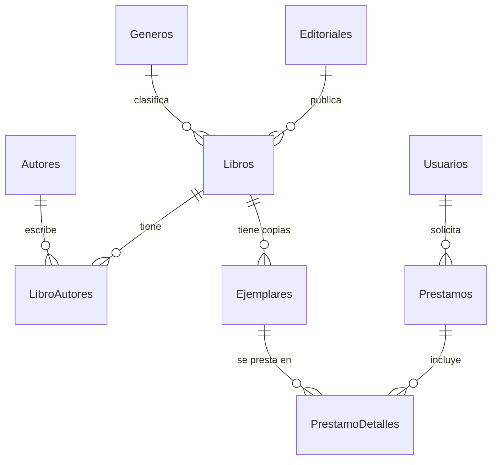

# Base de datos Biblioteca

Base de datos relacional para gestionar una biblioteca: libros, autores, editoriales, géneros, ejemplares físicos, usuarios y préstamos. El repositorio tiene dos versiones: la original en **MariaDB** y una versión mejorada en **SQL Server**, con diseño corregido, índices, datos de prueba y procedimientos almacenados con transacciones.

## Estructura del repositorio

```
biblioteca-DB-sql/
├── MariaDB/
│   └── bibliotecaDB.sql                    <- versión original
├── SQLServer/
│   ├── 01_CrearBaseDeDatos.sql
│   ├── 02_Catalogos.sql
│   ├── 03_Libros_Ejemplares_Usuarios.sql
│   ├── 04_Prestamos.sql
│   ├── 05_Indices.sql
│   ├── 06_DatosDePrueba.sql
│   ├── 07_Procedimientos_Prestamos.sql
│   └── 08_Procedimientos_Consultas.sql
└── README.md
```

## Modelo de datos (SQL Server)

La base se llama `BibliotecaDB` y tiene 9 tablas.



| Tabla | Descripción |
|---|---|
| `Editoriales`, `Generos`, `Autores` | Catálogos de apoyo |
| `Libros` | Títulos del catálogo, con editorial y género |
| `LibroAutores` | Relación muchos a muchos entre libros y autores |
| `Ejemplares` | Copias físicas de cada libro, con código único y estado (`disponible` o `prestado`) |
| `Usuarios` | Personas que piden libros, con correo único |
| `Prestamos` | Cada préstamo, con fecha de préstamo y fecha límite |
| `PrestamoDetalles` | Ejemplares incluidos en un préstamo, con su fecha de devolución (`NULL` mientras no se devuelve) |

## Mejoras de la versión SQL Server

- Los libros están relacionados con su editorial, y los autores con los libros mediante `LibroAutores` (un libro puede tener varios autores).
- Los préstamos tienen fecha límite, y cada ejemplar tiene su propia fecha de devolución.
- El estado de los ejemplares se valida con `CHECK` y las fechas de los préstamos también.
- Todas las restricciones tienen nombre propio (`PK_`, `FK_`, `UQ_`, `CK_`, `DF_`).
- Índices sobre las claves foráneas, y un índice único filtrado que impide prestar un mismo ejemplar dos veces mientras siga sin devolverse.
- Procedimientos almacenados con transacciones y errores propios.
- Datos de prueba que se pueden cargar varias veces sin duplicarse.

## Requisitos

- SQL Server (probado con SQL Server Express 2022).
- SQL Server Management Studio (SSMS) o cualquier cliente que ejecute T-SQL.

## Cómo ejecutarlo (SQL Server)

Ejecuta los scripts **en orden**. En SSMS: conéctate a tu servidor, abre una **nueva consulta**, pega el contenido de cada script y presiona F5. El primero se ejecuta desde `master`, porque la base todavía no existe; los demás ya trabajan dentro de `BibliotecaDB`. Todos se pueden repetir sin error.

| Orden | Script | Qué hace |
|---|---|---|
| 1 | `01_CrearBaseDeDatos.sql` | Crea la base `BibliotecaDB` |
| 2 | `02_Catalogos.sql` | Editoriales, géneros y autores |
| 3 | `03_Libros_Ejemplares_Usuarios.sql` | Libros, relación libro-autor, ejemplares y usuarios |
| 4 | `04_Prestamos.sql` | Préstamos y su detalle |
| 5 | `05_Indices.sql` | Índices y regla de un préstamo activo por ejemplar |
| 6 | `06_DatosDePrueba.sql` | Datos de ejemplo |
| 7 | `07_Procedimientos_Prestamos.sql` | Procedimientos para prestar y devolver |
| 8 | `08_Procedimientos_Consultas.sql` | Procedimientos de consulta |

## Procedimientos almacenados

| Procedimiento | Parámetros | Descripción |
|---|---|---|
| `usp_Prestamos_Registrar` | `@IdUsuario`, `@CodigosEjemplares` (separados por coma), `@DiasPrestamo` (14 por defecto) | Presta uno o varios ejemplares dentro de una transacción y devuelve el `IdPrestamo` |
| `usp_Prestamos_Devolver` | `@CodigoEjemplar` | Registra la devolución, deja el ejemplar disponible y devuelve los días de retraso |
| `usp_Libros_ObtenerDisponibles` | `@Titulo` (opcional) | Libros con ejemplares disponibles, con autores, editorial y género |
| `usp_Prestamos_ObtenerVencidos` | ninguno | Ejemplares sin devolver con la fecha límite vencida, del mayor al menor retraso |

Errores propios que pueden lanzar `usp_Prestamos_Registrar` y `usp_Prestamos_Devolver`:

| Código | Significado |
|---|---|
| 50101 | El usuario no existe |
| 50102 | Plazo fuera del rango permitido (1 a 60 días) |
| 50103 | No se indicó ningún ejemplar |
| 50104 | El ejemplar no existe |
| 50105 | El ejemplar no está disponible |
| 50111 | El ejemplar no existe (devolución) |
| 50112 | El ejemplar no tiene un préstamo abierto |

## Ejemplos de uso

```sql
USE BibliotecaDB;
GO

-- Prestar dos ejemplares a un usuario
EXEC dbo.usp_Prestamos_Registrar @IdUsuario = 1, @CodigosEjemplares = N'CIEN-001, CIEN-002';

-- Devolver un ejemplar
EXEC dbo.usp_Prestamos_Devolver @CodigoEjemplar = N'CIEN-001';

-- Libros disponibles y búsqueda por título
EXEC dbo.usp_Libros_ObtenerDisponibles;
EXEC dbo.usp_Libros_ObtenerDisponibles @Titulo = N'agua';

-- Préstamos vencidos
EXEC dbo.usp_Prestamos_ObtenerVencidos;
```

## Notas

- Los datos de prueba son ficticios. Sus fechas se calculan respecto al día en que se cargan, así que los préstamos vencidos cambian con el tiempo.
- Los números de `IdPrestamo` pueden saltarse valores después de pruebas con `ROLLBACK`: es el comportamiento normal de las columnas `IDENTITY`.

## Versión MariaDB

La carpeta `MariaDB/` conserva el script original, `bibliotecaDB.sql`, como referencia. En esa versión los autores y las editoriales no estaban relacionados con los libros, y los préstamos no tenían fecha de devolución; la versión de SQL Server corrige ambos puntos.

## Autor

Alan Humberto Ortega Aguayo